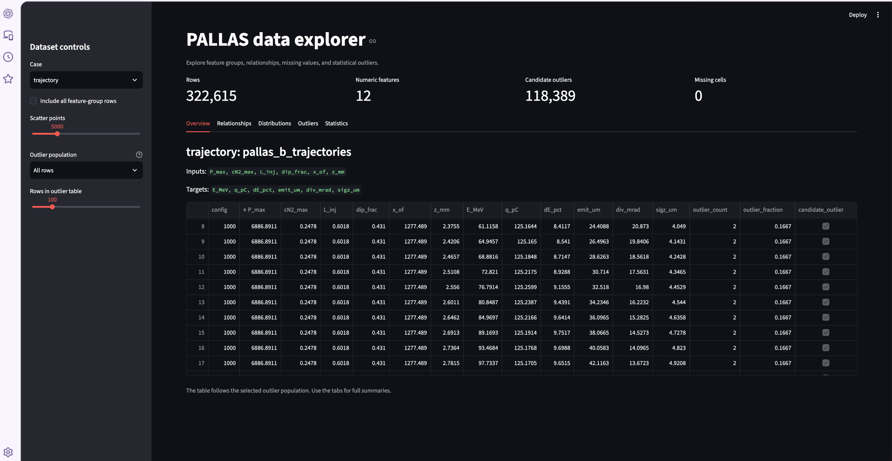
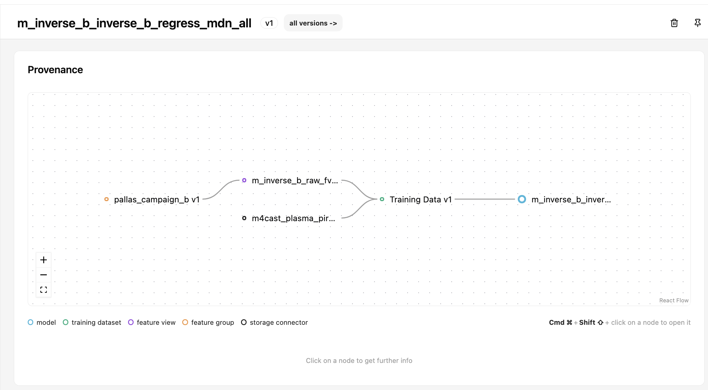

## Why do we need surrogate models?

::: {.columns}
::: {.column width="52%"}

### The scientific problem

Use this space for the motivation: what makes the full PALLAS simulation expensive, and which questions need rapid answers?

::: {.placeholder}
Add one sentence describing the simulation bottleneck.
:::

:::
::: {.column width="42%"}

::: {.accent-card}
**Central idea**

Replace repeated high-fidelity simulation runs with a fast, validated approximation.
:::

<iframe
  class="video-frame"
  src="https://www.youtube-nocookie.com/embed/xH0mQ93MpMc?autoplay=0&mute=1&enablejsapi=1&playsinline=1&rel=0"
  data-autoplay-src="https://www.youtube-nocookie.com/embed/xH0mQ93MpMc?autoplay=1&mute=1&enablejsapi=1&playsinline=1&rel=0"
  title="PALLAS simulation video"
  referrerpolicy="strict-origin-when-cross-origin"
  allow="accelerometer; autoplay; clipboard-write; encrypted-media; gyroscope; picture-in-picture; web-share"
  allowfullscreen>
</iframe>

:::
:::

## PALLAS in one view

::: {.placeholder .hero-placeholder}
Insert a PALLAS / accelerator schematic, simulation snapshot, or system diagram.
:::

::: {.caption}
Suggested content: beamline context, simulation inputs, and the observables produced by the simulation.
:::

## From simulation to surrogate

::: {.pipeline}
::: {.pipeline-step}
**01**  
Simulation settings

Beam, target, and machine parameters
:::
::: {.pipeline-arrow}
→
:::
::: {.pipeline-step}
**02**  
PALLAS simulation

High-fidelity trajectories and fields
:::
::: {.pipeline-arrow}
→
:::
::: {.pipeline-step}
**03**  
Training data

Features, targets, and quality checks
:::
::: {.pipeline-arrow}
→
:::
::: {.pipeline-step .highlight}
**04**  
Surrogate model

Fast predictions for R&D
:::
:::

::: {.notes}
Replace the labels above with the final data flow once the presentation narrative is settled.
:::

## Data exploration

<iframe
  class="video-frame video-feature"
  src="https://www.youtube-nocookie.com/embed/Bx12V2A3MlQ?autoplay=0&mute=1&enablejsapi=1&playsinline=1&rel=0"
  data-autoplay-src="https://www.youtube-nocookie.com/embed/Bx12V2A3MlQ?autoplay=1&mute=1&enablejsapi=1&playsinline=1&rel=0"
  data-video-url="https://youtu.be/Bx12V2A3MlQ"
  title="PALLAS data exploration demo"
  referrerpolicy="strict-origin-when-cross-origin"
  allow="accelerometer; autoplay; clipboard-write; encrypted-media; gyroscope; picture-in-picture; web-share"
  allowfullscreen>
</iframe>

## 1 · Read the simulation data from Hopsworks

::: {.columns}
::: {.column width="53%"}

{fig-alt="PALLAS Data Explorer showing the trajectory feature group and candidate outliers" width="96%"}

::: {.caption}
The same feature groups can be inspected interactively before they become model inputs.
:::

:::
::: {.column width="43%"}

### The pipeline starts with a feature store connection

```python
project = pp.connect(pp.PROJECT)
fs = project.get_feature_store()

case = pp.CASES[CASE]
fv = pp.get_feature_view(
    fs, f"{OWNER}_{CASE}_fv", FV_VERSION
)
rows = pp.read_rows(fv, case)
```

The selected **case** determines the feature group, input columns, target columns, and row filter. The feature view then applies the shared input normalisations stored in Hopsworks.

This keeps the experiment tied to a reproducible data definition rather than a manually exported table.

:::
:::

## 2 · Transform, train, score, and register

::: {.columns}
::: {.column width="48%"}

```python
TD_VERSION = pp.prepare_statistics(fv)
train_configs, holdout_configs, holdout_groups = pp.split_configs(
    rows, case, SPLIT, HOLDOUT_FRACTION, SEED
)

train_rows = rows[rows.config.isin(train_configs)]
X_train = pp.transform(fv, train_rows, case)
model = pp.SurrogateModel(
    model_module.build_model(**params),
    case.targets, TARGET_SCALING
)
model.fit(X_train, train_rows)
```

The split is made on complete **configurations**, so rows from a single simulation do not leak into both training and holdout data. The official scorer evaluates predictions on configurations the model has not seen.

:::
::: {.column width="48%"}

{fig-alt="Hopsworks provenance graph linking a feature group, feature view, training dataset, and registered model" width="98%"}

::: {.caption}
Hopsworks records the lineage from source feature group through feature view and training dataset to the registered model.
:::

::: {.accent-card}
**Registry hand-off**

The upload bundles the fitted model, metadata, code, metrics, feature-view version, and split. A later inference run can recover the same inputs and provenance.
:::

:::
:::

## Four modelling directions

::: {.cards}
::: {.model-card}
<div class="card-title">Trialling trajectory</div>
Predict the evolution of a particle or bunch along the trajectory.
:::
::: {.model-card}
<div class="card-title">Direct B</div>
Map simulation inputs to magnetic-field-related outputs.
:::
::: {.model-card}
<div class="card-title">Inverse B</div>
Infer the inputs or settings required to obtain a desired field response.
:::
::: {.model-card}
<div class="card-title">Inverse A</div>
Infer the accelerator or beam configuration from observed outcomes.
:::
:::

::: {.caption}
Confirm the final terminology and the exact input/target definitions for each case.
:::

## Data quality is part of the model

::: {.columns}
::: {.column width="46%"}

### Before training

::: {.check-list}
- Statistical description of each feature and target
- Correlations and redundant parameters
- Missing values and invalid physical states
- Candidate outliers and anomalous rows
:::

:::
::: {.column width="48%"}

::: {.placeholder .tall}
Insert a correlation matrix, outlier comparison, or representative distribution.
:::

:::
:::

## Identifying possible outliers in trajectories

::: {.columns}
::: {.column width="58%"}

<iframe
  class="plotly-frame outlier-histogram-frame"
  src="data/trajectory_histograms.html"
  title="Interactive trajectory feature histograms"
  loading="lazy">
</iframe>

::: {.caption}
Static Hopsworks snapshot: use the dropdown to inspect one trajectory feature at a time.
:::

:::
::: {.column width="38%"}

### How the method works

For every numeric trajectory input and target, the explorer applies two complementary univariate tests:

```python
q1, q3 = values.quantile([0.25, 0.75])
iqr = q3 - q1
iqr_flag = (values < q1 - 1.5 * iqr) | \
           (values > q3 + 1.5 * iqr)

median = values.median()
MAD = abs(values - median).median()
robust_z = abs(values - median) / (1.4826 * MAD)
robust_flag = robust_z > 3.5
```

The two flags are combined with an **OR**. A row becomes a candidate outlier when at least one selected feature is flagged. The method identifies candidates; it does not delete rows automatically.

:::
:::

## An interactive Plotly scatter plot

::: {.columns}
::: {.column width="68%"}

<div id="dummy-scatter-plot" class="plotly-demo" aria-label="Interactive Plotly scatter plot of dummy PALLAS data"></div>

<script src="https://cdn.plot.ly/plotly-2.35.2.min.js"></script>
<script>
  const dummyScatter = [
    {
      x: [5000, 5100, 5200, 5300, 5400, 5500, 5600, 5700, 5800, 5900, 6000, 6100, 6200, 6300, 6400, 6500, 6600, 6700, 6800, 6900],
      y: [61.2, 64.7, 68.1, 71.5, 75.0, 78.4, 81.9, 85.3, 88.8, 92.1, 95.7, 99.0, 102.6, 106.0, 109.4, 112.9, 116.2, 119.8, 123.1, 126.7],
      text: ['1001','1002','1003','1004','1005','1006','1007','1008','1009','1010','1011','1012','1013','1014','1015','1016','1017','1018','1019','1020'],
      name: 'Nominal', mode: 'markers', type: 'scatter', marker: {size: 10, color: '#22d3ee'}
    },
    {
      x: [5150, 5750, 6350, 6850], y: [84.0, 143.0, 72.0, 171.0],
      text: ['2001','2002','2003','2004'],
      name: 'Candidate outlier', mode: 'markers', type: 'scatter', marker: {size: 13, color: '#e879f9', symbol: 'diamond'}
    }
  ];
  Plotly.newPlot('dummy-scatter-plot', dummyScatter, {
    title: 'Dummy trajectory population: E_MeV vs P_max',
    xaxis: {title: 'P_max'}, yaxis: {title: 'E_MeV'},
    paper_bgcolor: 'rgba(0,0,0,0)', plot_bgcolor: 'rgba(13,27,42,0.75)',
    font: {color: '#e6edf3'}, legend: {orientation: 'h'},
    margin: {l: 60, r: 20, t: 55, b: 55}, height: 420
  }, {responsive: true, displaylogo: false});
</script>

:::
::: {.column width="28%"}

### What this demonstrates

- Hover over a point to inspect its configuration ID.
- Toggle populations from the legend.
- Compare a nominal trend with deliberately injected candidate outliers.
- Replace the inline arrays with data loaded from the real explorer output.

Dummy source data: [data/dummy_scatter.csv](../data/dummy_scatter.csv)

::: {.notes}
This example uses Plotly’s browser JavaScript bundle. The slide therefore remains interactive in HTML, but needs network access to load the CDN script unless Plotly is bundled locally.
:::

:::
:::

## Model experiments

::: {.placeholder .benchmark-placeholder}
Insert benchmark plot: linear baseline vs. `mlp_sklearn` vs. `torch_mlp`.
:::

::: {.caption}
Suggested annotations: case, train/test split, outlier policy, metric, and model registry version.
:::

## Results

::: {.columns}
::: {.column width="31%"}
::: {.metric-card}
**Metric**

`[ value ]`

Name the primary score.
:::
:::
::: {.column width="31%"}
::: {.metric-card}
**Speed-up**

`[ value ]`

Compare surrogate inference with simulation.
:::
:::
::: {.column width="31%"}
::: {.metric-card}
**Best case**

`[ case / model ]`

Record the strongest result.
:::
:::
:::

::: {.placeholder .result-placeholder}
Add the principal result figure or prediction-vs-truth plot here.
:::

## Takeaways and next steps

::: {.columns}
::: {.column width="50%"}

### Takeaways

::: {.placeholder .list-placeholder}
1.  
2.  
3. 
:::

:::
::: {.column width="44%"}

### Next steps

::: {.placeholder .list-placeholder}
- Validate on new simulation regimes
- Improve uncertainty estimates
- Connect models to the R&D workflow
:::

:::
:::

## Questions

::: {.closing-slide}
<div class="closing-title">Plasma Pirates</div>

Surrogate models of the PALLAS simulation

::: {.small}
Hayg Guler · Alexander Hill · Sébastien Joly · Keon Hee Kim · Mykyta Lenivenko · Guillermo Rodrîguez Llorente
:::
:::
